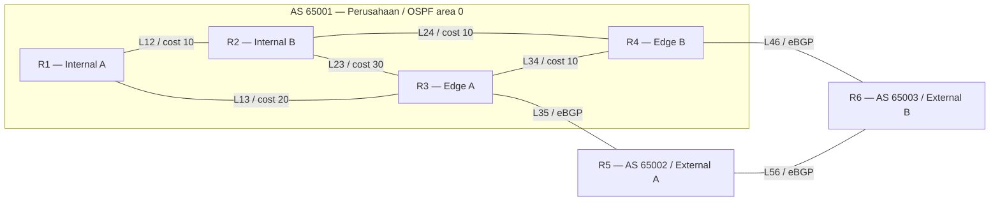

# Rancangan topologi enam router FRR

Tanggal rancangan: 19 November 2026. Baseline dan failover/pemulihan L12 serta L35 pernah lulus; status runtime saat ini harus diperiksa kembali. Implementasi: [panduan lab](../../lab/host1/frr/README.md). Hasil: [validasi](VALIDATION.md#lab-dan-telemetry). Reset/redeploy penuh dan fault lain belum dibuktikan oleh hasil tersebut.

## 1. Dasar kebutuhan dan keputusan

Rujukan kebutuhan adalah ringkasan spesifikasi dari pengguna di `../../private/.ai/sources/project-context-original.md`: enam router, corporate edge OSPF/BGP, jalur alternatif, smoke test MTU R1–R2, serta eksperimen 30 variasi fault. Dua slide asli dan dokumen spesifikasi asli belum tersedia dalam folder proyek; detail berikut merupakan keputusan desain, bukan persyaratan eksplisit dosen.

Dipilih **empat router dalam AS perusahaan dan dua AS eksternal**, dengan delapan link fisik. Empat router internal memberi ruang untuk membedakan kegagalan link, adjacency OSPF, transport iBGP, dan kebijakan BGP. Dua AS eksternal menyediakan primary/backup antar-AS serta eksperimen asymmetric routing.

## 2. Diagram link fisik

Garis diagram adalah link fisik, bukan seluruh sesi BGP. iBGP menggunakan loopback dan dapat melewati beberapa link OSPF.

## 3. Router dan addressing

| Router | Nama node | AS | Peran | Router-ID / loopback `lo` | Service pada `lo` | Management `eth0` |
|---|---|---:|---|---|---|---|
| R1 | r1 | 65001 | Internal A, target smoke MTU | 10.255.0.1/32 | 10.100.1.1/32 | 172.30.80.11/24 |
| R2 | r2 | 65001 | Internal B, target smoke MTU | 10.255.0.2/32 | 10.100.2.1/32 | 172.30.80.12/24 |
| R3 | r3 | 65001 | Edge ke AS 65002 | 10.255.0.3/32 | 10.100.3.1/32 | 172.30.80.13/24 |
| R4 | r4 | 65001 | Edge ke AS 65003 | 10.255.0.4/32 | 10.100.4.1/32 | 172.30.80.14/24 |
| R5 | r5 | 65002 | External A | 10.255.0.5/32 | 10.100.5.1/32 | 172.30.80.15/24 |
| R6 | r6 | 65003 | External B | 10.255.0.6/32 | 10.100.6.1/32 | 172.30.80.16/24 |

- ASN 65001–65003 adalah ASN privat untuk lab.
- Router-ID ditulis tanpa `/32` saat dimasukkan ke konfigurasi protokol.
- Service `/32` merupakan alamat uji pada router, bukan host/container tambahan. Dengan demikian jumlah router tetap enam; pengujian ini belum memodelkan LAN pengguna penuh.
- Loopback identitas memisahkan alamat sesi iBGP dari service yang diiklankan BGP.
- Management: rencana Docker network `rca-mgmt`, subnet `172.30.80.0/24`, gateway `172.30.80.1`; wajib periksa benturan subnet Docker/WSL/VPN sebelum deploy.
- `eth0` hanya untuk management. Jangan aktifkan OSPF atau peer BGP pada eth0, dan jangan iklankan subnet management. Validasi rute/probe harus memastikan trafik lab tidak keluar lewat default route management.

## 4. Link dan alamat interface

| ID | Endpoint A | IP A | Endpoint B | IP B | Subnet | Routing | OSPF cost kedua arah |
|---|---|---|---|---|---|---|---:|
| L12 | r1:eth1 | 10.0.12.1/30 | r2:eth1 | 10.0.12.2/30 | 10.0.12.0/30 | OSPF area 0 | 10 |
| L13 | r1:eth2 | 10.0.13.1/30 | r3:eth1 | 10.0.13.2/30 | 10.0.13.0/30 | OSPF area 0 | 20 |
| L24 | r2:eth2 | 10.0.24.1/30 | r4:eth1 | 10.0.24.2/30 | 10.0.24.0/30 | OSPF area 0 | 10 |
| L34 | r3:eth2 | 10.0.34.1/30 | r4:eth2 | 10.0.34.2/30 | 10.0.34.0/30 | OSPF area 0 | 10 |
| L23 | r2:eth3 | 10.0.23.1/30 | r3:eth3 | 10.0.23.2/30 | 10.0.23.0/30 | OSPF area 0 | 30 |
| L35 | r3:eth4 | 10.0.35.1/30 | r5:eth1 | 10.0.35.2/30 | 10.0.35.0/30 | eBGP 65001–65002 | — |
| L46 | r4:eth3 | 10.0.46.1/30 | r6:eth1 | 10.0.46.2/30 | 10.0.46.0/30 | eBGP 65001–65003 | — |
| L56 | r5:eth2 | 10.0.56.1/30 | r6:eth2 | 10.0.56.2/30 | 10.0.56.0/30 | eBGP 65002–65003 | — |

Pola oktet ketiga mengikuti pasangan router agar mudah dilacak. `/30` memberikan tepat dua alamat host dan mudah dipahami untuk lab; efisiensi alamat `/31` tidak menjadi kebutuhan utama. Semua data interface ditetapkan **MTU 1500**, tidak mengikuti MTU 9500 dari smoke test Alpine.

## 5. OSPF sebagai routing internal

- Hanya R1–R4 menjalankan OSPFv2, seluruh link internal berada di backbone area `0.0.0.0`.
- Gunakan network type point-to-point pada lima link internal, sehingga tidak perlu pemilihan DR/BDR pada veth dua endpoint.
- Aktifkan OSPF secara eksplisit pada interface yang diizinkan. Loopback pasif; alamat identitas dan service R1–R4 diketahui melalui OSPF.
- R5/R6 dan tiga link antar-AS tidak menjalankan OSPF. OSPF tidak membawa subnet management.
- Hello/dead direncanakan **1/4 detik**, sama pada kedua ujung. Ini parameter lab untuk eksperimen, bukan klaim waktu konvergensi terukur.
- Cost pada tabel sengaja berbeda untuk mengurangi ambiguitas jalur. Pada baseline: R1→R3 langsung cost 20; R1→R4 melalui R2 cost 20; R2→R3 melalui R4 cost 20, sementara L23 cost 30 menjadi cadangan. ECMP tidak diperlukan pada baseline ini.
- Tidak memakai `mtu-ignore`; mismatch MTU harus dapat terdeteksi. Tidak perlu multi-area untuk empat router internal.

OSPF menyediakan reachability loopback sehingga sesi iBGP tidak terikat pada satu interface fisik. Semua link internal berada pada siklus: putus satu link tidak memisahkan jaringan internal.

## 6. BGP: sesi dan kebijakan

### iBGP dalam AS 65001

Full mesh **enam sesi logis**: R1–R2, R1–R3, R1–R4, R2–R3, R2–R4, R3–R4. Masing-masing peer memakai `10.255.0.n` dengan source `lo`, address family IPv4 unicast. Tidak memakai route reflector untuk empat router.

R3 dan R4 menerapkan `next-hop-self` kepada seluruh peer iBGP untuk route yang dipelajari dari eBGP. Dengan demikian router internal dapat mencapai next hop melalui OSPF tanpa memasukkan link ISP ke OSPF. R1 dan R2 juga menjalankan BGP agar route eksternal tersedia ketika keduanya menjadi router transit; menjalankan BGP hanya pada edge akan meninggalkan celah forwarding pada core.

### eBGP langsung

| Sesi | Peer A | Peer B |
|---|---|---|
| R3–R5 | 10.0.35.1, AS 65001 | 10.0.35.2, AS 65002 |
| R4–R6 | 10.0.46.1, AS 65001 | 10.0.46.2, AS 65003 |
| R5–R6 | 10.0.56.1, AS 65002 | 10.0.56.2, AS 65003 |

Gunakan single-hop eBGP; tidak perlu multihop. Total baseline: **9 sesi BGP unik** (6 internal + 3 eksternal), atau 18 entri neighbor jika menghitung kedua sisi.

### Prefix dan policy eksplisit

Definisikan himpunan exact-match berikut, tanpa agregasi atau `le` yang terlalu luas:

- **C** = `10.100.1.1/32`, `10.100.2.1/32`, `10.100.3.1/32`, `10.100.4.1/32`.
- **A** = `10.100.5.1/32`.
- **B** = `10.100.6.1/32`.

Setiap router meng-originasi hanya service `/32` miliknya dengan BGP `network`; route tersebut harus ada pada RIB. Tidak melakukan redistribusi menyeluruh connected/OSPF/BGP. Untuk route C pada R1–R4, route OSPF dapat menjadi route aktif di RIB sementara BGP tetap membawa NLRI untuk export; jangan mengharuskan semua service internal berlabel BGP di `show ip route`.

| Router → peer | Export diizinkan | Import diizinkan |
|---|---|---|
| R3 → R5 | C | A + B |
| R4 → R6 | C | A + B |
| R5 → R3 | A + B | C |
| R6 → R4 | A + B | C |
| R5 → R6 | A + C | B + C |
| R6 → R5 | B + C | A + C |

Semua prefix lain ditolak. Tabel ini adalah batas izin, bukan jaminan seluruh prefix selalu diiklankan: selection BGP dan AS-path loop prevention tetap berlaku. Terapkan inbound/outbound prefix-list dan route-map eksplisit, pertahankan `bgp ebgp-requires-policy`. AS 65001 tidak menjadi transit R5↔R6. R5/R6 sengaja mengizinkan transit terbatas untuk menyediakan jalur cadangan perusahaan.

Preferensi di AS 65001:

- R3 menerima A dari R5 dengan LOCAL_PREF 200; B dari R5 dengan 100.
- R4 menerima B dari R6 dengan LOCAL_PREF 200; A dari R6 dengan 100.
- LOCAL_PREF didistribusikan ke peer iBGP, sehingga semua router internal sepakat memilih edge sesuai tujuan.
- R5 dan R6 menggunakan preferensi setara (100); route C langsung dari perusahaan memiliki AS_PATH lebih pendek daripada melalui AS eksternal lainnya.
- Tidak menggunakan multipath BGP, MED khusus, atau prepend pada baseline. Ini menyederhanakan penjelasan perubahan jalur.
- BGP keepalive/hold direncanakan **3/9 detik** pada seluruh sesi, lalu nilai negosiasinya diperiksa. BFD tidak diaktifkan pada baseline agar eksperimen hold expiry benar-benar mengukur mekanisme timer.

## 7. Jalur dan contoh failover yang diharapkan

| Probe bersumber dari service | Jalur normal | Saat gangguan |
|---|---|---|
| R1 service → A | R1–R3–R5 | L35 down: R1–R2–R4–R6–R5 |
| R1 service → B | R1–R2–R4–R6 | L46 down: R1–R3–R5–R6 |
| R1 service → B | R1–R2–R4–R6 | L12 down: R1–R3–R4–R6 |
| A → B | R5–R6 | L56 down: koneksi A↔B gagal; AS perusahaan bukan transit |

Jalur tabel adalah prediksi desain setelah konvergensi, bukan hasil traceroute. Normalnya jalur balik probe pertama dan kedua mengikuti urutan terbalik. Gangguan kebijakan dapat mengubahnya menjadi asimetris. Jangan menilai semua link failure harus memutus ping: failover bisa membuat ping tetap berhasil walaupun ada fault.

Probe lintas-AS harus menggunakan source service `/32`, misalnya R1 source `10.100.1.1`, karena loopback identitas dan subnet transit tidak di-export antar-AS. Router-ID R5/R6 tetap lokal, bukan target ping global. Aktifkan IPv4 forwarding di setiap router; pastikan Linux reverse-path filtering tidak strict pada data plane (`all` dan interface terkait) agar tidak mengacaukan eksperimen asimetri.

## 8. Kesesuaian dengan eksperimen fault

Topologi mendukung keluarga fault berikut. Ini pemetaan kemampuan desain, **bukan 30 skenario yang sudah tervalidasi**.

| Keluarga | Lokasi/contoh | Evidence utama |
|---|---|---|
| MTU mismatch | L12 wajib; L13/L24/L34/L23 alternatif | MTU kedua ujung, state adjacency, log, probe ukuran paket |
| OSPF adjacency | Area/timer mismatch, passive-interface keliru pada link internal | Config, neighbor, interface, LSDB |
| BGP session failure | Wrong remote-AS, shutdown neighbor, transport TCP terblokir | State FSM, log, peer config, counter transport |
| BGP hold expiry | Drop trafik BGP pada L35/L46/L56 sementara link tetap up | Negotiated hold, timestamp pesan terakhir, alasan reset |
| Route/policy | Prefix-filter salah, service tidak ter-originasi, next-hop-self hilang | BGP RIB, kernel route, policy, next-hop reachability |
| Jalur/asimetri | Cost satu arah, LOCAL_PREF/prepend salah, link down | Jalur pergi/balik, keputusan BGP/OSPF, route snapshot |

Untuk mencapai 30 variasi, tahap harness harus membuat katalog ID, mekanisme, target, ground truth, probe, reset, dan kriteria sukses per skenario. Jangan sekadar mengalikan kategori dengan router tanpa memastikan fault benar-benar dapat diamati.

Catatan eksperimen penting:

- MTU berbeda tidak selalu segera memutus adjacency yang sudah FULL. Untuk smoke R1–R2, desain injection harus mencatat perubahan MTU dan, bila dibutuhkan, memicu pembentukan ulang adjacency secara terkontrol. Probe besar dengan DF membantu membedakan MTU fault dari sekadar ping kecil yang tetap sukses. Semua stimulus tambahan masuk ground truth.
- Perbedaan konfigurasi BGP hold timer saja tidak otomatis memicu expiry; BGP menegosiasikan timer. Gunakan hilangnya pesan BGP dengan link tetap up, dan pastikan reason reset memang hold expiry, bukan interface-down atau TCP reset.
- Asimetri sendiri bukan selalu kesalahan jaringan. Skenario harus menetapkan pelanggaran baseline/policy atau dampak terukur yang dinilai sebagai fault.
- Ukur waktu injection→detection, diagnosis, apply, dan recovery secara terpisah. Hold 9 detik tidak memberi jaminan total <10 detik. Target <10 detik dari tugas berlaku pada smoke MTU dan tetap harus diuji bersama model dan konvergensi.

## 9. Rencana implementasi dan kriteria penerimaan

1. Image telah dipilih: `quay.io/frrouting/frr:containerlab-10.7.1`, native `kind: frr`; digest tercatat dalam `../topology/frr/image-lock.json` dan YAML. Binary melaporkan `10.7.1_git`. Containerlab 0.82.0 menerima YAML dan parser FRR menerima keenam konfigurasi; baseline runtime telah lulus; lihat VALIDATION.md.
2. Buat `lab/host1/frr/topology.clab.yml`, file `frr.conf` setiap router, pengaturan daemon, IPv4 forwarding, MTU, dan baseline reset di folder proyek. Daemon minimum: zebra/bgpd semua router, ospfd R1–R4. Layout bind mount dan permission drive D diuji sebelum deploy penuh.
3. Pastikan subnet management tidak bentrok dan startup tidak mengiklankan eth0. Simpan konfigurasi sumber terpisah dari hasil eksperimen; jangan menimpa baseline dengan perubahan fault.
4. Deploy di sesi NetworkLab persisten. Periksa enam container, delapan veth, 16 endpoint IP, MTU 1500, dan enam loopback/service.
5. OSPF: lima adjacency unik FULL; jumlah neighbor R1=2, R2=3, R3=3, R4=2, R5/R6=0. Loopback R1–R4 saling terjangkau sebelum iBGP.
6. BGP: sembilan sesi unik Established. Neighbor per router: R1=3, R2=3, R3=4, R4=4, R5=2, R6=2. Periksa route A/B di seluruh perusahaan, route C pada R5/R6, dan tidak ada prefix management/transit yang bocor.
7. Periksa next-hop resolvable, jalur tabel, dan ping service semua pasangan. Target service harus memakai data plane, bukan default route eth0.
8. Uji satu kegagalan internal dan satu eBGP, ukur failover, pulihkan baseline, lalu ulangi verifikasi. Kegagalan L56 tidak wajib pulih karena perusahaan non-transit.
9. Simpan config aktual, JSON neighbor/route, timestamp, ping/traceroute, log, dan checksum baseline di `data/host1/` dengan run ID. Baru tandai milestone implementasi selesai setelah bukti tersedia.

## 10. Referensi teknis

Diakses 19 November 2026; cek lagi terhadap versi FRR yang dipilih saat implementasi.

- [FRR OSPFv2](https://docs.frrouting.org/en/latest/ospfd.html): point-to-point, cost, timers, passive interface, pemeriksaan MTU.
- [FRR BGP](https://docs.frrouting.org/en/latest/bgp.html): iBGP, next-hop-self, policy eBGP, network import-check, LOCAL_PREF, timer.
- [RFC 8212](https://www.rfc-editor.org/info/rfc8212/): kebijakan eksplisit import/export eBGP.
- [Containerlab FRR](https://containerlab.dev/manual/kinds/frr/): integrasi FRR; bukan bukti kompatibilitas image tertentu dengan runtime lokal.

Pilihan AS, subnet, link, cost, policy, serta service pada dokumen ini adalah rancangan untuk tugas, bukan topologi yang disalin dari referensi.
